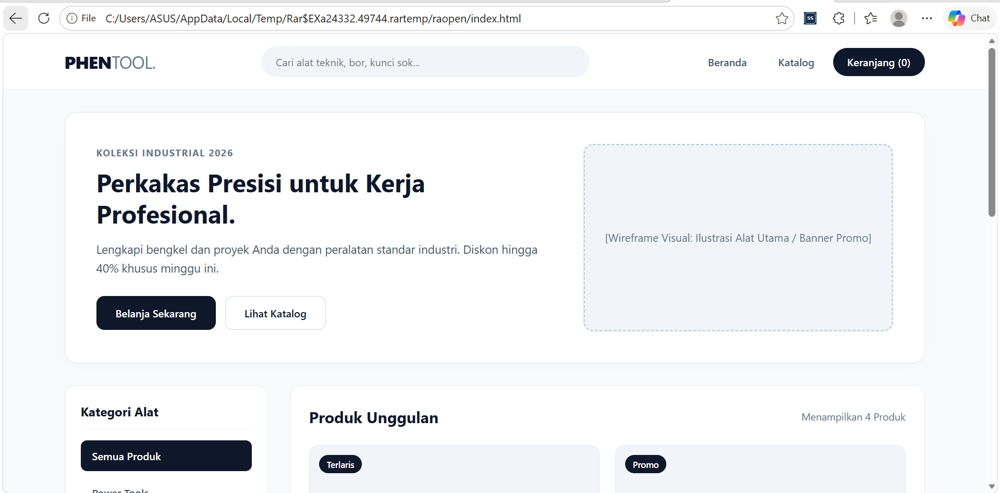

# PROFIL

* **Nama:** Prevansyah Sjafar
* **NPM:** 4525210057
* **Jurusan:** Teknik Informatika

## Phen Tool

Halaman web sederhana untuk toko online perkakas bernama Phen Tool. Tampilannya masih berupa wireframe, jadi gambar produk diganti dengan kotak abu-abu bertuliskan nama fotonya.

## Penjelasan Hasil Output & Fungsi Area

Halaman web ini terbagi menjadi 5 area utama:

1. **Area 1 - Header & Navigasi:** Berfungsi menampilkan identitas toko (logo `PHENTOOL.`), kolom pencarian barang, dan menu navigasi (`Beranda`, `Katalog`, `Keranjang`).
2. **Area 2 - Hero Banner:** Berfungsi sebagai area promosi utama di bagian atas halaman beserta tombol ajakan (*Call-to-Action* / `Belanja Sekarang`).
3. **Area 3 - Sidebar Kategori:** Berfungsi memudahkan pengunjung menyaring daftar produk berdasarkan kategori (`Semua Produk`, `Power Tools`, `Hand Tools`, `Alat Ukur Digital`, `Perlengkapan Safety`).
4. **Area 4 - Grid Katalog Produk:** Berfungsi menampilkan daftar produk yang dijual, terdiri dari kotak gambar produk, nama produk, harga, dan tombol `+ Keranjang`.
5. **Area 5 - Footer:** Berfungsi memuat informasi bagian bawah halaman, yaitu profil toko, layanan pelanggan, kontak, dan hak cipta.

## Perbedaan Tampilan Wireframe Desktop & Mobile

* **Tampilan Desktop (Layar > 768px):**
  * Header menampilkan logo, pencarian, dan menu secara sejajar ke samping (horizontal).
  * Banner dibagi 2 kolom: teks promosi di kiri dan kotak gambar di kanan.
  * Sidebar kategori berada di kiri, katalog produk di kanan.
  * Katalog ditampilkan berjajar menjadi **2 kolom** ke samping menggunakan CSS Grid.
  * Footer ditampilkan dalam **3 kolom**.
* **Tampilan Mobile (Layar <= 768px):**
  * Elemen pada Header otomatis tersusun menurun ke bawah (vertikal) agar nyaman diakses di layar ponsel.
  * Banner, sidebar, dan katalog bertumpuk ke bawah. Tombol kategori berjajar ke samping dan turun baris jika penuh.
  * Katalog produk otomatis menyesuaikan menjadi **1 kolom** penuh ke bawah.
  * Footer menjadi 1 kolom.

## Struktur Folder

```text
PrakDW_Tugas05_525210057_Prevansyah_sjafar/
├── index.html
├── README.md
├── css/
│   └── style.css
└── img/
    └── output1.png
```

## Screenshot

Tampilan desktop (header, banner, dan awal katalog):


